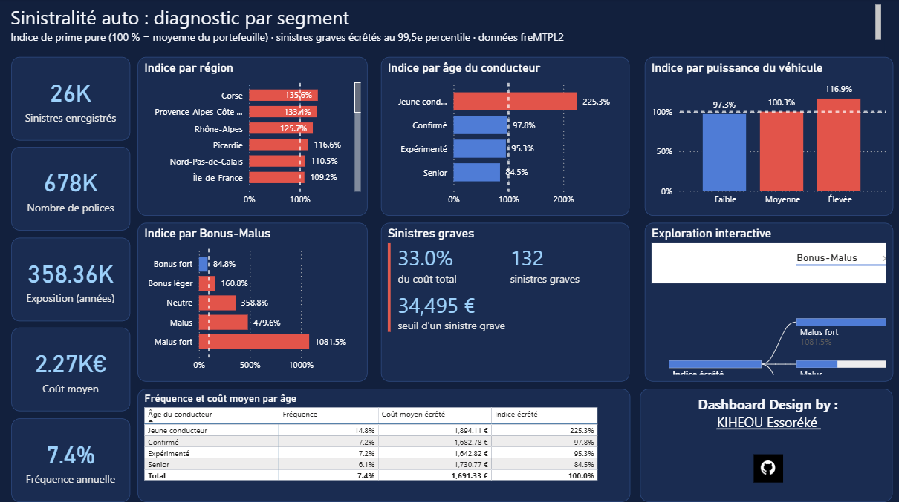
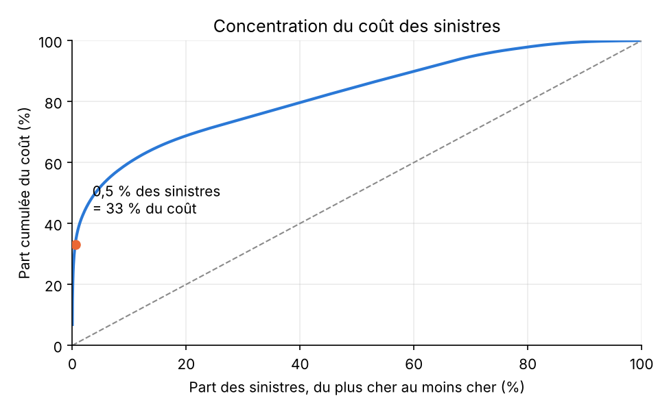
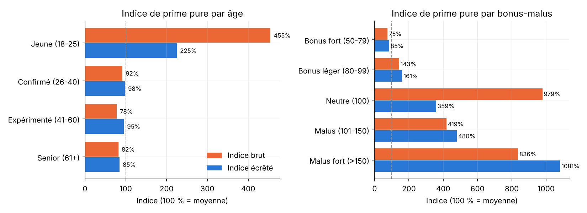
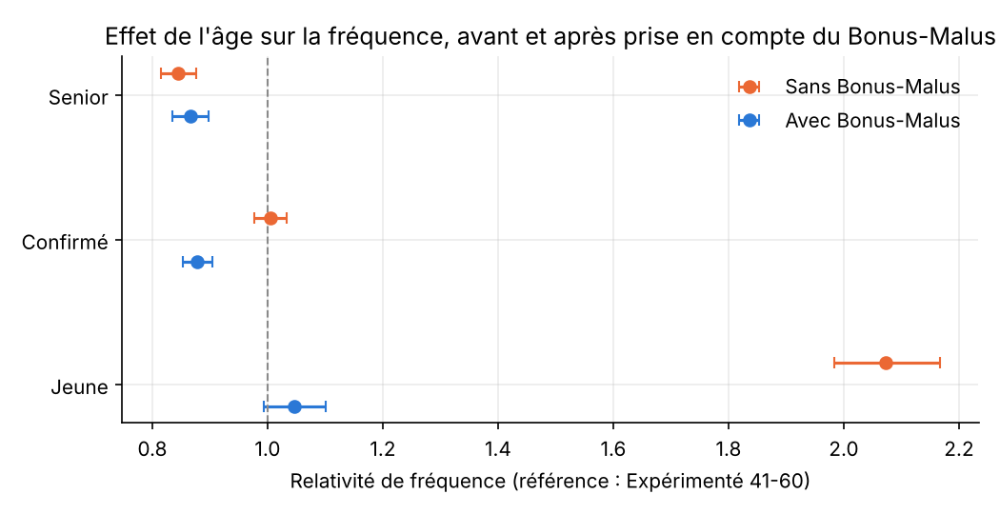
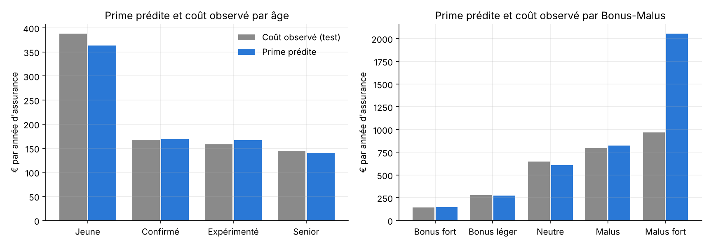

# Diagnostic de la sinistralité d'un portefeuille d'assurance automobile

Dashboard Power BI qui identifie les profils de conducteurs qui coûtent le plus cher à un assureur auto, avec une vérification statistique des résultats en Python.

> **En bref**
> - **Les jeunes conducteurs (18-25 ans) ont deux fois plus d'accidents que la moyenne.** Une année d'assurance d'un jeune coûte environ **2,25 fois plus** en sinistres qu'une année d'assurance moyenne (indice de prime pure de 225 %).
> - **Quelques accidents très graves pèsent énormément.** 132 sinistres, soit 0,5 % du total, représentent un tiers du coût. Un seul accident de 4,1 M€ suffisait à faire paraître certains profils trois fois plus risqués qu'ils ne le sont. Pour éviter ce piège, chaque sinistre est **plafonné** à 34 495 € dans les comparaisons (c'est ce qu'on appelle l'**écrêtement**).
> - **Le Bonus-Malus, la « note de conduite » des assurés, fonctionne bien** : plus elle est mauvaise, plus le conducteur a d'accidents. Le vrai enjeu est de bien tarifer les **nouveaux conducteurs**, qui n'ont pas encore d'historique, dès la signature du contrat.
>
> - **Un tarif a été construit et testé** sur des contrats jamais vus : il couvre les sinistres à 1,6 % près, et fait payer à chaque profil un prix proche de son coût réel. Avec un prix unique, **8 assurés sur 10 paieraient trop cher**.
>
> *Les termes techniques sont expliqués dans le [lexique](#lexique) ci-dessous.*



[Voir le dashboard complet (PDF, 2 pages)](docs/dashboard.pdf) · [Notebook de validation statistique](notebooks/validation_statistique.ipynb) · [Notebook de tarification](notebooks/tarification_glm.ipynb)

Projet Power BI visant à identifier les segments de clientèle qui coûtent le plus cher dans un portefeuille d'assurance auto et à formuler des recommandations tarifaires fondées sur les données.

## Lexique

| Terme | Ce que ça veut dire |
|---|---|
| **Sinistre** | Un accident ou un dommage déclaré à l'assureur, qui lui coûte de l'argent. |
| **Sinistralité** | L'ensemble des sinistres d'un groupe d'assurés : combien il y en a et combien ils coûtent. |
| **Exposition** | La durée pendant laquelle un contrat est assuré, en années. Un contrat souscrit en juillet compte pour 0,5 an la première année. On compare les profils « par année d'assurance » pour être juste. |
| **Fréquence** | Le nombre de sinistres par année d'assurance. Une fréquence de 7,4 % signifie environ 7 accidents par an pour 100 conducteurs. |
| **Coût moyen** | Le coût moyen d'un sinistre. |
| **Prime pure** | Ce que coûtent les sinistres d'un assuré en un an (fréquence × coût moyen). C'est le prix minimum à facturer pour couvrir les sinistres, avant les frais et la marge de l'assureur. |
| **Indice de prime pure** | La prime pure d'un profil comparée à la moyenne. 100 % = profil moyen ; 225 % = profil 2,25 fois plus coûteux ; 85 % = profil 15 % moins coûteux. |
| **Bonus-Malus** | La « note de conduite » de chaque assuré en France. Elle démarre à 100 pour un nouveau conducteur, baisse de 5 % par an sans accident responsable (jusqu'à 50, le meilleur niveau) et augmente de 25 % à chaque accident responsable (jusqu'à 350). En dessous de 100 : **bonus**, la prime baisse. Au-dessus de 100 : **malus**, la prime augmente. |
| **Sinistre grave** | Un sinistre exceptionnellement cher, souvent un accident avec des blessés. Ici, les 0,5 % de sinistres les plus chers (plus de 34 495 €). |
| **Écrêtement** | Plafonner chaque sinistre à un montant maximum (ici 34 495 €) pour comparer les profils. Un accident de 4 M€ compte alors pour 34 495 €. Le surplus n'est pas oublié : il est réparti sur l'ensemble des assurés, au lieu de faire paraître dangereux le petit groupe où il est tombé par hasard. |
| **Intervalle de confiance** | La fourchette dans laquelle se trouve très probablement la vraie valeur. Plus un profil compte de sinistres, plus la fourchette est étroite et le résultat fiable. |
| **Crédibilité** | Le degré de confiance qu'on peut accorder au résultat d'un profil. Sous 50 sinistres, il est trop fragile pour décider seul d'un tarif. |
| **GLM de Poisson** | Un modèle statistique standard en tarification. Il mesure l'effet de chaque caractéristique (âge, puissance, Bonus-Malus) **toutes choses égales par ailleurs**, c'est-à-dire en tenant compte des autres en même temps. |
| **GLM Gamma** | Le même type de modèle, adapté aux montants : il explique le **coût** d'un sinistre au lieu de leur nombre. |
| **Chargement** | Un supplément ajouté à toutes les primes. Ici, il finance la partie des sinistres graves retirée par l'écrêtement. |
| **Échantillon test** | Une partie des contrats (20 %) mise de côté pendant la construction du tarif, pour vérifier ensuite qu'il fonctionne sur des données qu'il n'a jamais vues. |
| **Coefficient de Gini** | Mesure si un tarif distingue bien les bons et les mauvais risques : 0 pour un prix unique, et plus il est élevé, mieux le tarif sépare les profils. |

## Contexte

Un assureur constate une hausse de sa sinistralité sans parvenir à identifier les segments de clientèle à l'origine du phénomène.
L'objectif est de déterminer quels profils génèrent le plus de pertes techniques, de distinguer les signaux réellement significatifs des effets liés à de faibles volumes de données et de proposer des actions correctives.

## Objectif

- Mesurer le coût relatif des segments du portefeuille.
- Identifier les populations les plus risquées.
- Analyser les facteurs expliquant les écarts de sinistralité.
- Formuler des recommandations de tarification exploitables par les équipes métier.

## Données

- **Source** : [freMTPL2freq / freMTPL2sev](https://www.openml.org/d/41214) - dataset public French Motor Third-Party Liability (Christophe Dutang, Computational Actuarial Science with R, CRC 2018)

**Volume analysé** :
- 678 007 contrats
- 26 383 sinistres
- 358 359 années d'exposition

**Variables clés** : exposition, âge conducteur, puissance véhicule, région, coefficient Bonus-Malus, montant des sinistres

## Méthodologie

### Préparation des données

- Nettoyage et contrôle qualité sous Power Query.
- Vérification des règles métier :
  - âge conducteur ≥ 18 ans ;
  - exposition comprise entre 0 et 1 an (aucune exposition supérieure à 1 dans le fichier utilisé) ;
  - Bonus-Malus compris entre 50 et 350.
- Jointure des données de fréquence et de sévérité.
- 256 sinistres du fichier des montants (920 000 €) n'ont pas de contrat correspondant : ils sont exclus des calculs.

### Modélisation

- Construction d'un modèle en étoile sous Power BI.
- Création de mesures DAX pour :
  - la fréquence des sinistres ;
  - le coût moyen par sinistre ;
  - la prime pure ;
  - l'indice de prime pure, brut et écrêté ;
  - les sinistres graves (seuil, nombre, part du coût) ;
  - la crédibilité des segments (intervalle de confiance de la fréquence, alerte sous 50 sinistres).

### Indicateur : l'indice de prime pure

En l'absence de primes réelles dans le jeu de données, chaque segment est comparé au portefeuille à partir de sa prime pure :

Prime pure = Fréquence des sinistres × Coût moyen par sinistre = Coût des sinistres / Exposition

**Indice de prime pure** = prime pure du segment / prime pure du portefeuille (100 % = moyenne).

Un indice de 225 % signifie qu'une année d'assurance de ce segment coûte 2,25 fois plus en sinistres que la moyenne. Ce n'est pas une rentabilité ni un loss ratio : il faudrait pour cela les primes réellement encaissées.

### Traitement des sinistres graves

Le coût des sinistres est très concentré : **0,5 % des sinistres représentent 33 % du coût total**, et le plus gros sinistre (4,1 M€) pèse à lui seul 6,8 % du coût.
Chaque sinistre est donc **plafonné au 99,5e percentile (34 495 €)** pour calculer l'indice écrêté. C'est la pratique actuarielle courante : la partie qui dépasse le seuil est mutualisée sur tout le portefeuille, au lieu d'être imputée au segment où le hasard l'a fait tomber.

### Contrôle statistique

- Vérification de la crédibilité des résultats selon les volumes observés.
- Mise en place d'un seuil de vigilance pour les segments comportant moins de 50 sinistres, et intervalle de confiance à 95 % sur la fréquence.
- Analyse croisée des variables afin d'identifier les principaux facteurs de risque et limiter les effets de confusion (exemple : âge du conducteur × puissance du véhicule).
- **Validation dans un notebook Python** ([validation_statistique.ipynb](notebooks/validation_statistique.ipynb)) :
  - reproduction des indices du dashboard ;
  - analyse de la concentration du coût et effet de l'écrêtement ;
  - intervalles de confiance exacts (loi de Poisson) ;
  - GLM de Poisson sur la fréquence (âge, puissance, Bonus-Malus, interaction), avec correction de la surdispersion.

## Résultats

### Préalable : quelques sinistres pèsent très lourd



> **Ce que ça veut dire.** Si tous les sinistres coûtaient la même chose, la courbe suivrait la diagonale en pointillés. Elle monte au contraire très vite : les 0,5 % de sinistres les plus chers (132 accidents) représentent 33 % de tout ce que l'assureur a payé.
> Conséquence pratique : dans un petit groupe de conducteurs, un seul accident grave peut faire exploser la moyenne et donner une fausse image du risque. C'est pourquoi tous les résultats ci-dessous sont présentés avec écrêtement (chaque sinistre plafonné à 34 495 €).

### 1. Jeunes conducteurs : une fréquence deux fois plus élevée

Les conducteurs âgés de 18 à 25 ans représentent **5,7 % du portefeuille**, mais ont une fréquence de **14,8 %**, contre 7,4 % en moyenne. L'intervalle de confiance est serré (14,2 % à 15,4 %).
Leur indice de prime pure écrêté est de **225 %**, contre 85 % à 98 % pour les autres tranches d'âge.

L'indice brut (455 %) surestimait l'écart : un seul sinistre de 4,1 M€ (conducteur de 19 ans) en expliquait une grande partie.



> **Ce que ça veut dire.** Sur 100 jeunes conducteurs assurés pendant un an, on compte environ 15 accidents, contre 7 pour 100 conducteurs en moyenne. Ce n'est pas un hasard : la fourchette de confiance est très étroite, car le résultat repose sur plus de 2 400 sinistres.
> En coût, un jeune conducteur revient à l'assureur environ 2,25 fois plus cher qu'un conducteur moyen, et non 4,5 fois comme l'indiquait le calcul sans plafond. La différence venait d'un seul accident exceptionnel.
> Le graphique le montre : les barres orange (sans plafond) exagèrent les écarts, les barres bleues (avec plafond) donnent la vraie hiérarchie des risques.

### 2. Effet combiné âge × puissance : un signal réel mais modeste

Les jeunes conducteurs de véhicules de puissance moyenne (7 à 9) ont une fréquence **2,3 fois** supérieure à la moyenne.
Le GLM de Poisson montre une **interaction âge × puissance d'environ +25 %** sur la fréquence : ces jeunes ont 25 % de sinistres en plus de ce que prédisent l'âge et la puissance séparément (p ≈ 0,01 après correction de la surdispersion).

Leur indice écrêté est de **295 %**. L'indice brut de 897,6 % et le « coût moyen 3,9 fois plus élevé » venaient presque entièrement du sinistre de 4,1 M€ : sans lui, le coût moyen n'est plus que 1,4 fois la moyenne.

> **Ce que ça veut dire.** Le jeune âge et la puissance du véhicule se cumulent : un jeune au volant d'une voiture de puissance moyenne a encore un peu plus d'accidents (+25 %) que ce qu'on attendrait en additionnant simplement les deux effets.
> L'effet est réel, mais modeste. Le premier calcul suggérait un profil 9 fois plus coûteux que la moyenne ; en réalité, il l'est environ 3 fois. C'est un signal à prendre en compte dans le tarif, pas une alerte rouge.
> Le « p ≈ 0,01 » signifie que, si cet effet n'existait pas, il n'y aurait qu'environ 1 chance sur 100 d'observer un écart pareil par hasard : le résultat est donc fiable.

### 3. Le Bonus-Malus fonctionne : l'enjeu est la souscription des nouveaux conducteurs

La fréquence augmente régulièrement avec le coefficient : **6,4 %** en bonus fort, 11,7 % en bonus léger, 21,2 % au niveau neutre (100), 34,6 % en malus et 56,8 % en malus fort.

Une fois le Bonus-Malus pris en compte dans le GLM, **l'effet propre de l'âge sur la fréquence disparaît** (relativité 1,05, non significative). Le Bonus-Malus capte donc déjà le sur-risque des jeunes conducteurs.

Le niveau neutre (100) a un indice écrêté de **359 %** (979 % en brut, à cause du même sinistre de 4,1 M€). Il regroupe surtout des nouveaux conducteurs : **42 % des contrats à 100 sont des jeunes**, contre 5,7 % dans le portefeuille. Un assuré sans historique démarre à 100, et le Bonus-Malus ne peut pas encore le distinguer : c'est à la souscription que le tarif doit faire la différence.



> **Ce que ça veut dire.** Le Bonus-Malus, la note de conduite des assurés, fait bien son travail : les bons conducteurs (bonus fort) ont environ 6 accidents par an pour 100 conducteurs, alors que les plus mauvais (malus fort) en ont près de 57.
> Le graphique montre une découverte importante. Si l'on regarde l'âge seul (points orange), les jeunes semblent deux fois plus risqués. Mais à Bonus-Malus égal (points bleus), un jeune n'a pas plus d'accidents qu'un conducteur de 41-60 ans. Autrement dit, ce qui compte surtout n'est pas l'âge en lui-même, mais l'absence d'historique de conduite, que le Bonus-Malus résume déjà.
> Le problème se situe donc au moment de la souscription : un nouveau conducteur démarre à 100, sans historique, et le Bonus-Malus ne peut pas encore distinguer un futur bon conducteur d'un futur mauvais. Pendant ces premières années, c'est à l'assureur d'ajuster le prix avec d'autres informations, comme l'âge et le véhicule.

### 4. Un tarif : fréquence × coût moyen

Le [notebook de tarification](notebooks/tarification_glm.ipynb) transforme le diagnostic en prix :

**Prime pure = fréquence (GLM de Poisson) × coût moyen d'un sinistre (GLM Gamma) × (1 + chargement pour les sinistres graves)**

- **Le coût d'un sinistre dépend très peu du profil.** L'âge et la puissance n'ont pas d'effet significatif sur le coût d'un accident. Seuls les nouveaux conducteurs (Bonus-Malus à 100) ont des sinistres environ **27 % plus chers**. Les écarts de prix viennent donc surtout de la fréquence.
- **Le chargement pour les sinistres graves est de +37 %** : c'est ce qu'il faut ajouter à toutes les primes pour financer la partie des sinistres au-delà de 34 495 €.
- **La grille tarifaire** part d'un prix de base de **154 € par an** (41-60 ans, petite voiture, bonus maximal), multiplié par des coefficients : ×4,1 pour un Bonus-Malus à 100, ×5,6 en malus, ×1,15 pour un véhicule puissant, ×1,20 pour un jeune au volant d'une voiture moyenne…

| Exemple de profil | Prime pure annuelle |
|---|---|
| Conducteur de 41-60 ans, petite voiture, bonus maximal | 154 € |
| Senior, voiture moyenne, bonus maximal | 134 € |
| Jeune conducteur débutant, petite voiture | 619 € |
| Jeune conducteur débutant, voiture moyenne | 726 € |
| Conducteur de 30 ans avec un malus | 796 € |

**Validation sur 20 % des contrats mis de côté :**
- les primes prédites couvrent les sinistres écrêtés à **1,6 %** près ;
- pour chaque âge et chaque niveau de Bonus-Malus, la prime prédite est proche du coût observé ;
- le tarif sépare bien les risques (coefficient de Gini de **0,18**, contre 0 pour un prix unique). Avec un prix unique de 169 €, **80 % des assurés paieraient plus que leur risque**, de 12 % en médiane.



> **Ce que ça veut dire.** On passe du constat (« les débutants coûtent plus cher ») à un prix concret : un jeune débutant devrait payer environ 4 à 5 fois le prix du conducteur le plus sûr, avant les frais et la marge de l'assureur.
> Sur le graphique, les barres grises (ce que les assurés ont réellement coûté) et les barres bleues (ce que le tarif leur ferait payer) sont proches pour presque tous les groupes : chacun paie à peu près ce qu'il coûte. C'est l'objectif d'un bon tarif.
> La seule exception est le malus fort, où le tarif est trop élevé : cette classe ne compte que 10 sinistres dans l'échantillon test, trop peu pour un coefficient fiable. En pratique, on la regrouperait avec le malus.
> Enfin, un prix unique serait injuste : 8 assurés sur 10 paieraient trop. Les bons conducteurs partiraient chez un concurrent moins cher, et l'assureur garderait surtout les profils risqués (c'est l'**antisélection**).

## Recommandations métier

1. **Tarifer les nouveaux conducteurs dès la souscription.** Pour les contrats sans historique (Bonus-Malus à 100), appliquer une majoration selon l'âge, renforcée pour les jeunes au volant d'un véhicule de puissance moyenne ou élevée. Le Bonus-Malus prend ensuite le relais. D'après la grille tarifaire, un jeune débutant devrait payer de 4 à 5 fois le prix de base selon son véhicule.
2. **Traiter les sinistres graves à part.** Écrêter les sinistres au-delà du seuil et financer leur surcoût par une charge mutualisée sur tout le portefeuille (ou par la réassurance), plutôt que de surtarifer un segment à cause d'un sinistre isolé.
3. **Ne pas réviser le tarif d'un segment sur un indice brut.** Toujours vérifier le nombre de sinistres, l'intervalle de confiance et l'indice écrêté. Par exemple, la région R21 (Champagne-Ardenne) affichait 240 % à cause d'un seul sinistre de 369 000 € : son indice écrêté est proche de la moyenne.

> **En résumé pour l'assureur :**
> - faire payer un peu plus les nouveaux conducteurs jeunes dès la signature du contrat, en particulier selon le véhicule ;
> - laisser ensuite le Bonus-Malus ajuster le prix selon leur conduite réelle ;
> - financer les accidents exceptionnels collectivement plutôt que de pénaliser au hasard un groupe d'assurés ;
> - avant de changer un prix, vérifier qu'un résultat repose sur assez de sinistres et ne dépend pas d'un seul accident.

## Compétences mobilisées
- Power BI
- Power Query
- DAX
- Modélisation de données
- Data Visualisation
- Analyse statistique
- Modèles linéaires généralisés (GLM de Poisson, GLM Gamma)
- Tarification actuarielle (prime pure, grille tarifaire, validation sur échantillon test)
- Python (pandas, statsmodels)
- Assurance IARD
- Data Storytelling
- Aide à la décision

## Stack technique
- **Power Query** : nettoyage et préparation des données
- **DAX** : mesures actuarielles (fréquence, sévérité, prime pure, indice de prime pure brut et écrêté, sinistres graves, crédibilité), mise en forme conditionnelle par règles
- **Power BI** : modélisation en étoile, arborescence de décomposition interactive, paramètre de champ, projet Power BI (.pbip) versionné sous Git
- **Python** : pandas, statsmodels (GLM de Poisson, quasi-Poisson, GLM Gamma), scipy, matplotlib

## Limites

- Les données ne contiennent pas les primes réellement facturées aux assurés. L'indice de prime pure compare donc des coûts entre segments ; il ne mesure ni une rentabilité ni un loss ratio.
- Certains segments présentent des volumes de sinistres limités. Par exemple, le Malus fort ne compte que 54 sinistres : sa fréquence est connue avec une marge large (environ 43 % à 74 %). Ces résultats doivent être interprétés avec prudence.
- Le seuil d'écrêtement (99,5e percentile) est un choix de méthode : un autre seuil changerait légèrement les indices, sans modifier les conclusions.
- Le notebook de validation porte sur la fréquence ; le coût des sinistres est modélisé par un GLM Gamma dans le notebook de tarification. Le tarif obtenu est une **prime pure** : un tarif commercial ajouterait les frais de gestion, la marge et les taxes.
- Le tarif n'utilise que trois critères pour rester lisible. La région, l'âge du véhicule ou la densité de population l'amélioreraient. La classe malus fort, trop petite, devrait être regroupée avec le malus.
- Le modèle de fréquence présente une surdispersion (≈ 3), due à des variables non incluses (région, âge du véhicule, densité). Elle est corrigée par une approche quasi-Poisson.
- Le jeu de données ne comporte pas d'informations relatives à la fraude, qui pourrait expliquer une partie de la sinistralité observée.
- L'analyse repose sur un historique figé et ne prend pas en compte l'évolution temporelle du portefeuille ou des comportements des assurés.

## Ouvrir le projet

**Dashboard Power BI**
1. Télécharger `freMTPL2freq.csv` et `freMTPL2sev.csv` (lien dans la section Données) et les placer dans le dossier `data/`.
2. Ouvrir `powerbi/Ratio Loss Auto.pbip` avec Power BI Desktop.
3. Dans **Transformer les données**, remplacer le chemin des deux sources par celui du dossier `data/`, puis **Actualiser**.

**Notebook**
```bash
pip install -r requirements.txt
jupyter notebook notebooks/validation_statistique.ipynb
jupyter notebook notebooks/tarification_glm.ipynb
```

## Structure du repo

```
├── README.md
├── requirements.txt
├── data/                          # fichiers CSV freMTPL2 (non versionnés)
├── powerbi/
│   ├── Ratio Loss Auto.pbip       # projet Power BI (à ouvrir avec Power BI Desktop)
│   ├── Ratio Loss Auto.Report/    # pages, visuels et thème
│   └── Ratio Loss Auto.SemanticModel/  # modèle de données et mesures DAX (model.bim)
├── notebooks/
│   ├── validation_statistique.ipynb   # contrôles, écrêtement, GLM de fréquence
│   └── tarification_glm.ipynb         # GLM Gamma, grille tarifaire, validation
└── docs/
    ├── dashboard.pdf              # export du dashboard (2 pages)
    ├── dashboard.png
    └── figures/                   # graphiques du notebook
```

## Contact

Essoréké KIHEOU - [LinkedIn](https://www.linkedin.com/in/essor%C3%A9k%C3%A9-kiheou-93996541b) - essorekekiheou@gmail.com
